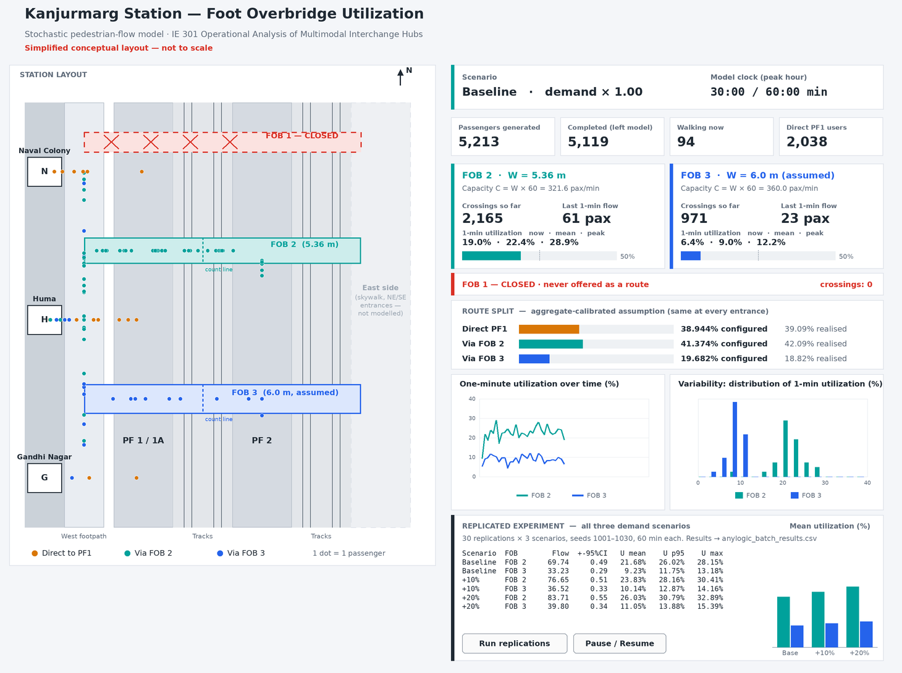
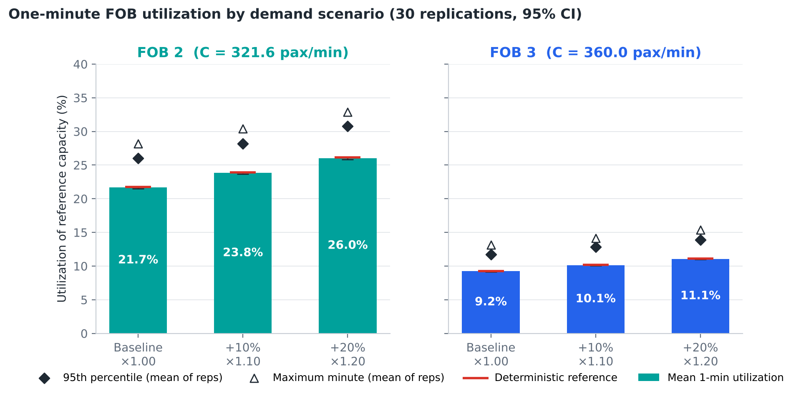
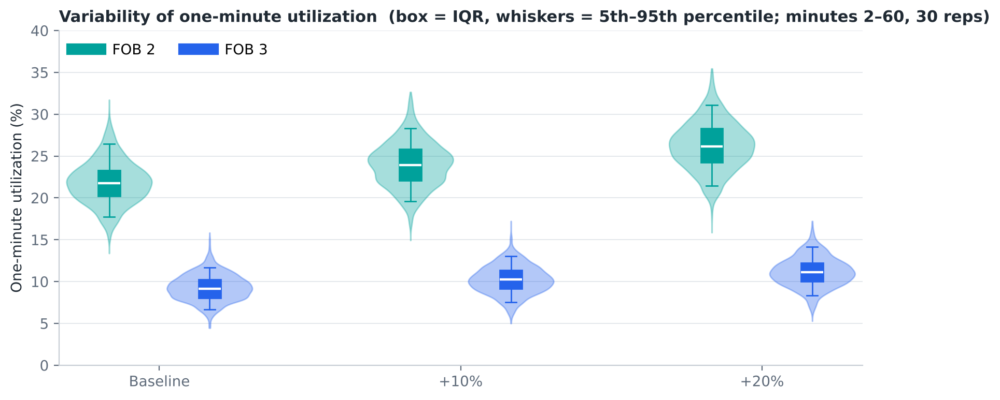
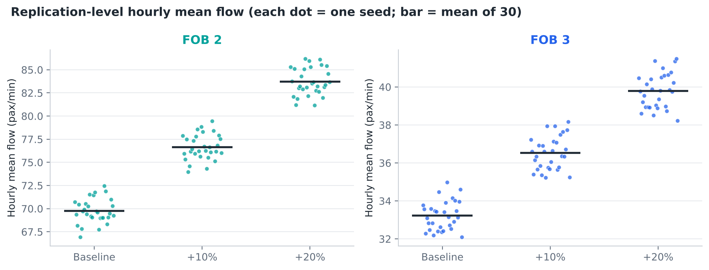
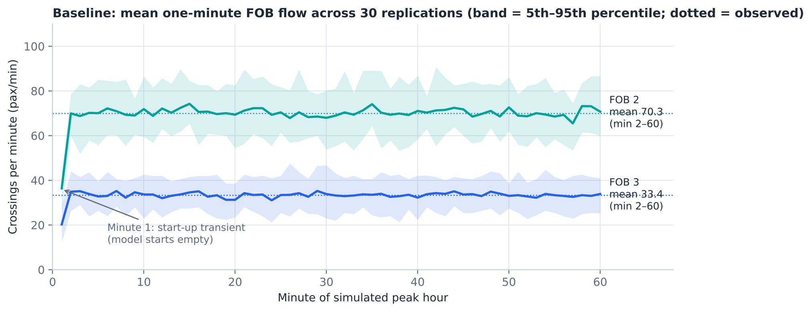
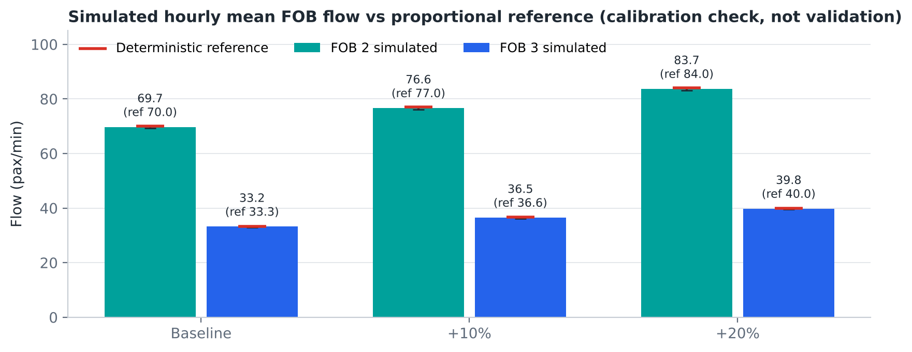
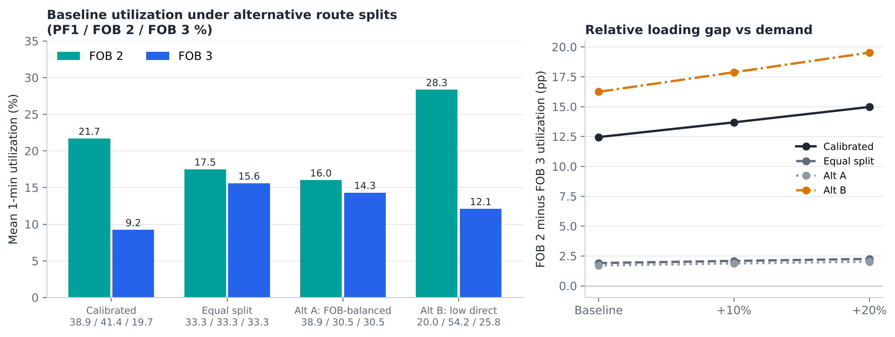

# Kanjurmarg Station: Stochastic Simulation of Foot Overbridge Utilization Under Increased Passenger Demand

*IE 301 · Operational Analysis of Multimodal Interchange Hubs — Technical report · Department of IEOR, IIT Bombay · October 2026*

| Key result | Value | Note |
|---|---:|---|
| FOB 2 baseline utilization | **21.7%** | → 26.0% at +20% demand |
| FOB 3 baseline utilization | **9.2%** | → 11.1% at +20% demand |
| Highest simulated minute | **35.4%** | FOB 2, +20% demand (of reference capacity) |

*Utilization = one-minute FOB crossings ÷ reference capacity (W × 60 pax/m/min). Mean of 30 stochastic replications per scenario. Demand increases are hypothetical scenarios, not ridership forecasts. Station layout is a simplified conceptual representation — not to scale.*


## 1. Executive Summary

This report builds and analyses a stochastic simulation of how peak-period passengers at Kanjurmarg railway station reach the platforms through three west-side entrances (Naval Colony, Huma and Gandhi Nagar) using one of three routes: direct level access to PF1, foot overbridge (FOB) 2, or FOB 3. FOB 1 is closed and is never available. The model was used to test baseline demand and hypothetical demand increases of 10% and 20%, motivated by possible future metro integration.

Passenger arrivals are modelled as six independent Poisson processes (three entrances × entering/leaving) at the rates observed by the project team. Each passenger then chooses a route at random using an **aggregate-calibrated split**: 38.944% direct PF1, 41.374% FOB 2 and 19.682% FOB 3. These shares were derived from the observed flows, so reproducing the observed FOB flows is **calibration, not independent validation**. Thirty independent replications of a 60-minute peak period were run for each scenario.

**Principal findings**

- **Baseline loading is low relative to the reference capacity.** FOB 2 carries 69.74 ± 0.49 pax/min (mean one-minute utilization 21.7%) and FOB 3 carries 33.23 ± 0.29 pax/min (9.2%), 95% confidence intervals.
- **Demand growth raises utilization proportionally.** At +10% demand the means are 23.8% (FOB 2) and 10.1% (FOB 3); at +20% they are 26.0% and 11.1%. The 95th-percentile minute on FOB 2 rises from 26.0% to 30.8%, and the single busiest simulated minute across all runs reaches 35.4%.
- **Minute-to-minute randomness matters more than replication-to-replication randomness.** Within a run, one-minute FOB 2 utilization varies with a standard deviation of about 2.9 percentage points, while the hourly mean varies between replications by only ±0.15 points (95% CI).
- **The relative loading of the two FOBs does not change with demand in this model.** FOB 2 carries 67.7% of the combined FOB flow in every scenario (≈ 2.10 times FOB 3). This is a direct consequence of holding route probabilities fixed; the absolute gap between the two FOBs widens from 12.5 to 15.0 percentage points.
- **Conclusions about the FOB balance depend strongly on the route split, but conclusions about adequacy do not.** Under an equal one-third split FOB 2 and FOB 3 are nearly balanced (17.5% vs 15.6%); if fewer passengers use direct PF1 access (Alt B), FOB 2 rises to 28.3%. In no tested case does a one-minute value approach 100% of reference capacity.

> **Interpretation.** Under the 60 pax/m/min reference intensity and the recorded or assumed widths, neither operational FOB approaches its reference capacity even with 20% more demand. However, utilization here is a reference-capacity ratio, not a level-of-service or safety assessment; train-release platoons, stair and escalator bottlenecks and the unverified FOB 3 width are not captured, so the result should be read as a screening-level indication rather than proof of adequacy.


## 2. Problem Definition and Objectives

Kanjurmarg (Central Line suburban station) is expected to become an interchange with Metro Lines 4 and 6. The project report recorded that the station has three FOBs, of which one (FOB 1, at the Naval Colony end) is closed, so all bridge movement between the west side and the island platform currently relies on FOB 2 and FOB 3. Metro integration could raise peak pedestrian demand, and the question is how the operational FOBs would be loaded if that happens.

The study answers six questions:


1. How is passenger demand distributed between direct PF1 access, FOB 2 and FOB 3?
1. What are the baseline utilization levels of FOB 2 and FOB 3?
1. What changes under +10% and +20% passenger demand?
1. How much do results vary because passenger arrivals and route choices are stochastic?
1. How sensitive are the results to the assumed route distribution?
1. Does the demand increase change the relative loading of the two operational FOBs?

> **Scope note.** The +10% and +20% demand levels are hypothetical scenarios motivated by possible metro integration. They are not forecasts of post-metro ridership.


## 3. Scope and Simplified Station Layout

The layout follows the team's hand-drawn station sketch. Along the west side, from north to south, the order is: Naval Colony entrance, FOB 2, Huma entrance, FOB 3, Gandhi Nagar entrance. FOB 1 lies at the northern (Naval Colony) end and is closed. PF1/1A is the platform adjacent to the west-side entrances; PF2 is the island platform beyond the tracks. The east side (skywalk and the north-east/south-east entrances) is drawn for context only.


**Figure 1.** Simplified conceptual layout used in the AnyLogic model (not to scale). Dots are simulated passengers at minute 30 of the baseline run (seed 1001): amber = direct PF1, teal = via FOB 2, blue = via FOB 3. Dotted lines mark where FOB crossings are counted.


**Table 1. Model scope.**

| Included | Excluded |
|---|---|
| Three west entrances: Naval Colony, Huma, Gandhi Nagar | East-side entrances (NE/SE) as passenger sources |
| Entering and leaving streams at each entrance (6 streams) | Ticket counters and queues, buses, autos |
| Routes: direct PF1, FOB 2, FOB 3 | Metro train operations, other stations |
| FOB 1 shown as closed (never selectable) | Stair/escalator capacity, density, speed, queuing |
| One-minute FOB crossing counts and utilization | Interventions or redesigns |

All three routes are physically available from every modelled entrance in the simplified network: entrances open onto a west-side footpath that runs the full length of PF1 and meets the western stairs of both FOBs. Direct PF1 access is an alternative pedestrian route, not an additional bridge.


## 4. Observed Data and Input Parameters

All numerical inputs come from the team's field observations recorded in the IE 301 project report (Sections 2.2, 2.3 and 4.6). Values are peak-period rates in passengers per minute.


**Table 2. Observed entrance flows (pax/min).**

| Entrance | Entering | Leaving | Total activity |
|---|---:|---:|---:|
| Naval Colony | 10.00 | 42.00 | 52.00 |
| Huma | 27.20 | 50.00 | 77.20 |
| Gandhi Nagar | 33.33 | 6.66 | 39.99 |
| **Total** | **70.53** | **98.66** | **169.19** |

*Source: IE 301 project report, Section 2.2 (team field counts). The east-side grouped count (20 in / 10 out) is outside the model scope.*


**Table 3. Observed facility flows and physical parameters.**

| Facility | Observed flow (pax/min) | Share of FOB 2+3 | Width (m) | Width status |
|---|---:|---:|---:|---:|
| FOB 1 | Closed | – | – | Not in use |
| FOB 2 | 70.0 | 67.76% | 5.36 | Recorded on sketch; clear width to be verified |
| FOB 3 | 33.3 | 32.24% | 6.0 | **Provisional assumption — not measured** |
| FOB 2 + FOB 3 | 103.3 | 100% | – | – |

*Source: project report Sections 2.3, 4.4 and 4.6; FOB 3 width specified as a provisional value for this study.*


> **Data limitation.** The total recorded entrance activity (169.19 pax/min) exceeds the combined FOB flow (103.3 pax/min) by 65.89 pax/min. The project data do not establish that entrance and FOB counts were taken synchronously across a common boundary, so this difference cannot be proven to be the actual direct-PF1 flow.


## 5. Aggregate-Calibrated Route Distribution

There is no measured route-choice matrix by entrance. The model therefore uses one aggregate split for every entrance and direction, obtained by dividing each route's reference flow by the total entrance activity:


**p_PF1 = 65.89 / 169.19 = 0.389444**   (5.1)


**p_FOB2 = 70.00 / 169.19 = 0.413736**   (5.2)


**p_FOB3 = 33.30 / 169.19 = 0.196820**   (5.3)

The exact fractions are used in the code (not rounded percentages). By construction 169.19 × p_FOB2 = 70.00 and 169.19 × p_FOB3 = 33.30, so the **expected** FOB flows reproduce the observations before random variation.


**Table 4. Route probabilities applied to every entrance and direction.**

| Entrance | Direct PF1 | Via FOB 2 | Via FOB 3 | Via FOB 1 |
|---|---:|---:|---:|---:|
| Naval Colony | 38.944% | 41.374% | 19.682% | 0% (closed) |
| Huma | 38.944% | 41.374% | 19.682% | 0% (closed) |
| Gandhi Nagar | 38.944% | 41.374% | 19.682% | 0% (closed) |


> **What this distribution is — and is not.** The 65.89 pax/min direct-PF1 flow is an **inferred residual**, not an observation. Because the route shares were chosen from the observed FOB flows, agreement between simulated and observed FOB flows is **calibration, not independent validation**. Identical shares at every entrance is an assumption of convenience: in reality Naval Colony users may favour FOB 2 and Gandhi Nagar users FOB 3. Identifying true entrance-specific route choices requires origin–route counts at each entrance (Section 13).


## 6. Stochastic Arrival and Route-Choice Model


### 6.1 Distributions chosen

Two random processes drive the model, and each was chosen as the simplest defensible first approximation for the available data:


**Table 5. Probability distributions and modelling choices.**

| Model element | Distribution / rule | Parameters | Why chosen |
|---|---|---|---|
| Passenger arrivals (each of 6 streams) | Poisson process: N(t) ~ Poisson(λt) | λ = observed rate × scenario multiplier | Many independent pedestrians; only a mean rate is known |
| Inter-arrival times | Exponential | Mean 60/λ seconds | Equivalent to a Poisson process |
| Route choice per passenger | Categorical (multinomial) draw by inverse CDF | p = (0.3894, 0.4137, 0.1968) | Only aggregate route shares are known |
| Walking speed | Deterministic | 1.30 m/s | Affects only crossing timing (14–60 s) |
| Random numbers | java.util.Random, one stream per arrival stream | seed × 1000 + stream index | Reproducible, independent streams |


### 6.2 Poisson arrivals

For a stream with mean rate λ (pax/min), the number of arrivals in t minutes and the time between arrivals are:


**N(t) ~ Poisson(λt),   P(N(t) = k) = e^(−λt) (λt)^k / k!**   (6.1)


**Δt ~ Exponential(λ),   E[Δt] = 1/λ min = 60/λ s**   (6.2)


**Δt = −ln(1 − U) · 60/λ   with  U ~ Uniform(0, 1)**   (6.3)


**Table 6. The six Poisson arrival streams (baseline).**

| Entrance | Direction | λ (pax/min) | Mean inter-arrival (s) | Expected per hour | +10% λ | +20% λ |
|---|---:|---:|---:|---:|---:|---:|
| Naval Colony | Entering | 10.00 | 6.00 | 600 | 11.00 | 12.00 |
| Naval Colony | Leaving | 42.00 | 1.43 | 2520 | 46.20 | 50.40 |
| Huma | Entering | 27.20 | 2.21 | 1632 | 29.92 | 32.64 |
| Huma | Leaving | 50.00 | 1.20 | 3000 | 55.00 | 60.00 |
| Gandhi Nagar | Entering | 33.33 | 1.80 | 2000 | 36.66 | 40.00 |
| Gandhi Nagar | Leaving | 6.66 | 9.01 | 400 | 7.33 | 7.99 |

Why Poisson: with many passengers arriving independently from a large catchment, the superposition of their arrivals is well approximated by a Poisson process, and it needs only the mean rate, which is all the field data provide. Its variance equals its mean, so it carries a natural level of minute-to-minute randomness.

Why it is only a first approximation: suburban stations receive passengers in **platoons** when a train unloads, and peak-period rates rise and fall within the hour. Both effects make real one-minute peaks larger and more clustered than a constant-rate Poisson process predicts. The simulated 95th-percentile and maximum minutes should therefore be read as lower bounds on true peak-minute loading.


### 6.3 Route choice and crossing count

Immediately after arriving, each passenger draws a uniform random number U and takes the first route whose cumulative probability exceeds U (direct PF1 if U < 0.3894, FOB 2 if U < 0.8032, otherwise FOB 3). FOB 1 is not in the route list, so it can never be selected. A passenger on an FOB route is counted **once**, in the one-minute interval in which they reach the FOB deck mid-point (the count line between PF1 and PF2). Direct-PF1 passengers never touch an FOB count.


### 6.4 Estimating variability across replications

Each replication uses a different seed and gives one value of each performance measure (for example the hourly mean flow). Across n = 30 replications the mean and its 95% confidence interval are:


**x̄ ± t(0.975, n−1) · s / √n,   with t(0.975, 29) = 2.045**   (6.4)

The same 30 seeds (1001–1030) are used in every scenario (**common random numbers**), so scenario differences are not obscured by different random draws. The model starts empty with no warm-up period, as required; the effect of this is quantified in Section 10.


## 7. Capacity and Utilization Calculations

Following the project's capacity framework, the reference pedestrian capacity of a facility is:


**C = W × I × T**   (7.1)

where W is the effective usable width (m), I the reference flow intensity (60 pax/m/min) and T the interval (min). For a one-minute interval C = 60W. Utilization of an interval is the observed or simulated crossing count Q in that same minute divided by C:


**U = Q / C × 100%**   (7.2)


**Table 7. Reference capacities and observed-flow benchmarks.**

| Facility | W (m) | C (pax/min) | Observed Q (pax/min) | Benchmark U |
|---|---:|---:|---:|---:|
| FOB 2 | 5.36 | 321.6 | 70.0 | 21.77% |
| FOB 3 | 6.0 (assumed) | 360.0 | 33.3 | 9.25% |


**Table 8. Deterministic observed-flow benchmark (proportional scaling — NOT simulation output).**

| Scenario | FOB 2 flow | FOB 2 U | FOB 3 flow | FOB 3 U |
|---|---:|---:|---:|---:|
| Baseline | 70.00 | 21.77% | 33.30 | 9.25% |
| +10% | 77.00 | 23.94% | 36.63 | 10.18% |
| +20% | 84.00 | 26.12% | 39.96 | 11.10% |

*Calculated as observed flow × demand multiplier ÷ capacity. Reported separately from the stochastic results in Section 10.*


> **Limits of the capacity proxy.** C = WIT with I = 60 pax/m/min is a theoretical reference intensity, not a measured capacity. The resulting U is a reference-capacity ratio, not a pedestrian level-of-service or safety assessment. It ignores stairs and escalators (often the real bottleneck), counter-flow, platoon arrivals, obstructions that reduce clear width, and crowd density. FOB 2's width must be verified as clear usable width, and FOB 3's 6.0 m is an assumption: U scales with 1/W, so if FOB 3's clear width were, say, 4.0 m its utilization would be 1.5 times higher.


## 8. AnyLogic Implementation

The model is a native AnyLogic 8.8 project (Kanjurmarg_FOB_Simulation.alp, model time unit = seconds). It uses core AnyLogic agent-based elements rather than Pedestrian Library blocks, so that every arrival, route choice and crossing is explicit in code that can be inspected and tested.


**Table 9. Model structure.**

| Element | Type | Role |
|---|---|---|
| Main | Top-level agent | Station layout, parameters, statistics, dashboard |
| passengers (Passenger) | Agent population | One dot per passenger, coloured by route, walking the layout |
| Arrival(stream) | Dynamic event | Poisson arrival: draw route, create passenger, schedule next arrival |
| Waypoint(p) | Dynamic event | Moves a passenger to its next way-point |
| Crossing(route) | Dynamic event | Counts an FOB crossing in the current minute |
| minuteTick | Cyclic event (60 s) | Closes each minute: flow, utilization, charts |
| FobEngine | Java class (Additional class code) | Stochastic core shared by animation and batch runs |
| runBatch() | Function + button | 30 replications × 3 scenarios inside AnyLogic, with 95% CIs; writes CSV |

**Interface.** The start page offers scenario selection (Baseline, +10%, +20%), random seed, number of replications, run duration and FOB 3 width. The run screen shows the animated layout with FOB 1 clearly marked closed, a live clock, generated/completed/walking passenger counters, FOB 2 and FOB 3 crossing counts, live one-minute utilization bars, the configured and realised route split, a time plot of one-minute utilization, a histogram of utilization variability, and a scenario-comparison chart filled by the replication button. Start, pause and reset are also available on AnyLogic's standard toolbar.




**Figure 2.** Model screen design, drawn from the shapes stored in the .alp file with values from the baseline run at minute 30 (seed 1001). This is a rendering of the model's layout for the report — not a screenshot taken in AnyLogic.


> **Verification status.** AnyLogic was not available in the environment where the model was built, so the .alp has **not yet been opened or run in AnyLogic**. All model code was compiled with javac against stand-ins for the AnyLogic functions it uses, and the model's event logic was executed headless. It reproduced replication 1 of the batch exactly (4,244 FOB 2 and 2,027 FOB 3 crossings, identical minute by minute). Opening the project in AnyLogic 8.8 is the remaining check (Appendix).


## 9. Experimental Design


**Table 10. Experiments.**

| Factor | Setting |
|---|---|
| Demand scenarios | Baseline ×1.00, +10% ×1.10, +20% ×1.20 applied to all six stream rates |
| Held constant | Route probabilities, layout, widths, capacity parameters, walking speed |
| Run length | 60 minutes (configurable) |
| Replications | 30 per scenario (configurable); seeds 1001–1030; common random numbers |
| Initial state | Empty station, no warm-up (configurable in engine) |
| Route sensitivity | 4 route splits × 3 scenarios × 30 replications (Section 11) |
| Total runs | 360 replications (12 configurations × 30) |

**Outputs per FOB and replication:** hourly mean crossing flow; mean, 95th-percentile and maximum one-minute utilization; standard deviation of one-minute utilization; plus the number of passengers assigned to direct PF1 and the count on FOB 1 (always zero). Utilization is calculated minute by minute from the actual crossings in that minute, not from the hourly total.


## 10. Simulation Results


### 10.1 Flow allocation

On average a baseline replication generates 10,183 passengers in 60 minutes, of whom 3,958 (38.9%) take the direct PF1 route. These passengers are reported for transparency and never contribute to FOB counts. FOB 1 recorded zero crossings in all 360 replications.


### 10.2 FOB flow and utilization by scenario


**Table 11. Stochastic simulation results (mean ± 95% CI half-width over 30 replications).**

| Scenario | FOB | Flow (pax/min) | Mean U (%) | P95 U (%) | Max-minute U (%) | Highest minute, all reps (%) | Within-run SD of U (pp) |
|---|---:|---:|---:|---:|---:|---:|---:|
| Baseline | FOB 2 | 69.74 ± 0.49 | 21.68 ± 0.15 | 26.02 ± 0.36 | 28.15 ± 0.48 | 31.72 | 2.89 |
| Baseline | FOB 3 | 33.23 ± 0.29 | 9.23 ± 0.08 | 11.75 ± 0.18 | 13.18 ± 0.38 | 15.83 | 1.63 |
| +10% | FOB 2 | 76.65 ± 0.51 | 23.83 ± 0.16 | 28.16 ± 0.34 | 30.41 ± 0.51 | 32.65 | 3.05 |
| +10% | FOB 3 | 36.52 ± 0.33 | 10.14 ± 0.09 | 12.87 ± 0.16 | 14.16 ± 0.41 | 17.22 | 1.75 |
| +20% | FOB 2 | 83.71 ± 0.55 | 26.03 ± 0.17 | 30.79 ± 0.44 | 32.89 ± 0.50 | 35.45 | 3.27 |
| +20% | FOB 3 | 39.80 ± 0.34 | 11.05 ± 0.10 | 13.88 ± 0.17 | 15.39 ± 0.34 | 17.22 | 1.84 |

*Source: data/scenario_summary.csv. P95 and Max are computed within each replication and then averaged.*




**Figure 3.** Mean one-minute utilization (bars, 95% CI), mean within-run 95th percentile and maximum minute, against the deterministic reference (red).


**Table 12. Change from baseline.**

| FOB | Scenario | Δ Flow (pax/min) | Δ Mean U (pp) | Δ P95 U (pp) | Δ Max-minute U (pp) |
|---|---:|---:|---:|---:|---:|
| FOB 2 | +10% | +6.91 | +2.15 | +2.13 | +2.26 |
| FOB 2 | +20% | +13.97 | +4.34 | +4.77 | +4.74 |
| FOB 3 | +10% | +3.29 | +0.91 | +1.12 | +0.98 |
| FOB 3 | +20% | +6.57 | +1.82 | +2.14 | +2.21 |


### 10.3 Variability

Two kinds of variability appear. **Within a run**, one-minute FOB 2 flow fluctuates around its mean with a standard deviation of about 2.9 percentage points of utilization (Figure 4), which is why the busiest minute is 6.5 points above the hourly mean on average. **Between runs**, the hourly mean flow differs from seed to seed with a standard deviation of 1.31 pax/min for FOB 2 and 0.77 pax/min for FOB 3 (Figure 5), giving narrow confidence intervals. Thirty replications were therefore sufficient; increasing them was not necessary.




**Figure 4.** Distribution of one-minute utilization (minutes 2–60, all 30 replications). Boxes show the interquartile range, whiskers the 5th–95th percentiles.




**Figure 5.** Hourly mean flow in each replication. The spread shows the replication-to-replication variation used for the confidence intervals.


### 10.4 Time profile and start-up transient




**Figure 6.** Baseline mean one-minute flow over the simulated hour (band = 5th–95th percentile across replications; dotted lines = observed values).

Because the model starts empty, FOB-bound passengers need 14–60 seconds to reach the count line, so minute 1 records only about half the steady flow (36.4 vs ≈ 70 pax/min on FOB 2). This lowers the 60-minute mean by roughly 0.8%. Excluding minute 1, the baseline means are 70.30 (FOB 2) and 33.45 pax/min (FOB 3). The no-warm-up setting was kept as specified; the warm-up length is a configurable engine parameter.


### 10.5 Comparison with the observed benchmark




**Figure 7.** Simulated hourly mean flow (95% CI) against the deterministic proportional reference.

Simulated baseline means differ from the observed values by -0.26 pax/min (FOB 2, -0.37%) and -0.07 pax/min (FOB 3, -0.21%), mainly because of the start-up transient. This close agreement is **expected by construction** and confirms the implementation is consistent. It is calibration, not evidence that the model reproduces real passenger behaviour.


## 11. Route Sensitivity Analysis

To test how much the conclusions depend on the assumed split, three alternative distributions were simulated with the same seeds and all three demand scenarios. These are **sensitivity assumptions, not observed behaviour**.


**Table 13. Route-split sensitivity (mean one-minute utilization, %).**

| Route split | PF1 / FOB2 / FOB3 (%) | FOB 2 base | FOB 3 base | FOB 2 +20% | FOB 3 +20% | FOB 2 max-min. +20% | FOB 2 share of FOB flow (%) |
|---|---:|---:|---:|---:|---:|---:|---:|
| Calibrated (primary) | 38.9 / 41.4 / 19.7 | 21.68 | 9.23 | 26.03 | 11.05 | 32.89 | 67.7 |
| Equal split | 33.3 / 33.3 / 33.3 | 17.50 | 15.59 | 20.98 | 18.72 | 27.21 | 50.1 |
| Alt A: FOB-balanced | 38.9 / 30.5 / 30.5 | 16.01 | 14.30 | 19.19 | 17.17 | 25.01 | 50.0 |
| Alt B: low direct PF1 | 20.0 / 54.2 / 25.8 | 28.34 | 12.10 | 34.03 | 14.50 | 41.76 | 67.7 |

*Source: data/route_sensitivity.csv. Alt A keeps the inferred PF1 share and splits the FOB share equally; Alt B assumes only 20% use direct PF1 and keeps the observed 67.8 : 32.2 FOB ratio.*




**Figure 8.** Left: baseline utilization under four route splits. Right: gap between FOB 2 and FOB 3 utilization as demand rises.

**Findings.** (i) The **balance** between the FOBs is entirely driven by the route split: with equal FOB shares the two bridges are within about 2 percentage points of each other (FOB 3 is slightly lower only because its assumed width is larger). (ii) The **absolute level** depends mainly on how many passengers are assumed to bypass the bridges via direct PF1 access: if only 20% do (Alt B), FOB 2 reaches 28.3% at baseline and its busiest minute averages 41.8% at +20%. (iii) In every case utilization rises linearly with demand and stays far below 100% of reference capacity. Aggregate calibration establishes consistency with the selected observations; it does not identify the true entrance-specific probabilities.


## 12. Interpretation and Operational Implications

**Q1 — Demand distribution.** Under the calibrated assumption about 39% of west-side movements use direct PF1 access, 41% FOB 2 and 20% FOB 3. Only the FOB shares are anchored in observation; the PF1 share is a residual.

**Q2 — Baseline utilization.** FOB 2 ≈ 21.7% and FOB 3 ≈ 9.2% of reference capacity on average, with typical peak minutes (95th percentile) of 26.0% and 11.7%.

**Q3 — Effect of demand growth.** Each 10% of demand adds about 2.1 points to FOB 2's mean utilization and 0.9 to FOB 3's; FOB 2's 95th-percentile minute reaches 30.8% at +20%. The response is linear because the model contains no congestion feedback.

**Q4 — Stochastic variation.** Minute-scale randomness is substantial: the busiest minute of a run averages 30% (FOB 2) and 43% (FOB 3) above the hourly mean, while hourly means are stable across replications (95% CI ±0.15 points or less). Operational planning should therefore look at peak minutes, not hourly averages — and real platoon arrivals will make peaks sharper than modelled here.

**Q5 — Sensitivity to route split.** High for the FOB 2 : FOB 3 balance and moderate for absolute levels; low for the qualitative conclusion that both FOBs remain well below reference capacity.

**Q6 — Relative loading.** No change: FOB 2 carries 67.7% of FOB flow in all scenarios. This is an assumption-driven result (fixed route probabilities), not an empirical finding. The absolute gap grows (12.5 → 15.0 pp), so any future imbalance problem would appear on FOB 2 first. If metro passengers arrive mainly via Gandhi Nagar (the shortest proposed metro connection, about 238 m, is to Gandhi Nagar Metro), FOB 3's share could increase — this cannot be tested without entrance-specific route data.


> **Operational implications.** (1) Bridge deck width does not appear to be the binding constraint under the reference benchmark, consistent with the project report's aggregate V/C of 0.23. (2) Attention should go to the elements this model excludes: staircases and escalators at FOB landings (the report observed 81.7% of one vertical pair using the escalator), train-release surges, and route choice. (3) Re-opening FOB 1 or redirecting flows is not supported or rejected by this analysis, because route choice is fixed by assumption.


## 13. Assumptions, Limitations, and Additional Data Required


### 13.1 Assumptions register


**Table 14. Assumptions, evidence status and implications.**

| ID | Assumption | Value | Evidence status | Implication |
|---|---|---|---|---|
| A1 | Route choice probabilities | PF1 38.944% / FOB2 41.374% / FOB3 19.682% (exact fractions 65.89, 70.00, 33.30 over 169.19) | Assumption derived from observations (calibration) | Expected FOB flows match the observations by construction; agreement is NOT independent validation |
| A2 | Direct PF1 flow | 65.89 pax/min | Inferred, not measured | If counts were not synchronous over a common boundary, the true PF1 share could differ substantially |
| A3 | Same route split at all entrances and both directions | Identical probabilities for all 6 streams | Assumption | Entrance-level FOB loading (e.g. Naval Colony favouring FOB 2) cannot be represented |
| A4 | Arrival process | Six independent Poisson processes (exponential inter-arrival times, mean 60/lambda s) | Modelling assumption | Train-release platoons are not represented, so true one-minute peaks are likely higher than simulated |
| A5 | Constant arrival rates over 60 min | Observed rates x scenario multiplier | Assumption | Within-hour peaks and troughs are not represented |
| A6 | Independent random route choice per passenger | Inverse-CDF draw on uniform(0,1) | Assumption | No density-dependent or familiarity-based switching between FOBs |
| A7 | Demand scenarios | x1.00, x1.10, x1.20 applied to every stream | Hypothetical scenario, not a forecast | Results describe sensitivity to uniform growth, not predicted post-metro ridership |
| A8 | FOB 2 width | 5.36 m | Recorded; clear usable width unverified | Capacity 321.6 pax/min; a narrower clear width raises utilization proportionally |
| A9 | FOB 3 width | 6.0 m | UNVERIFIED assumption | Capacity 360 pax/min; FOB 3 utilization scales with 1/W |
| A10 | Flow intensity I | 60 pax/m/min | Reference value | Utilization is a reference-capacity ratio, not a level-of-service or safety assessment |
| A11 | Walking speed | 1.30 m/s, constant | Assumption | Only shifts when a crossing is counted (delay 14-60 s); does not change counts materially |
| A12 | Crossing point | FOB deck mid-point between PF1 and PF2 | Modelling convention | Passengers still on the approach at t = 60 min are not counted |
| A13 | Initial state / warm-up | Model starts empty, no warm-up | Assumption | Minute 1 has fewer crossings (start-up transient), lowering 60-min mean flow by about 1% |
| A14 | Replications and seeds | 30 replications, seeds 1001-1030, common random numbers across scenarios | Experimental design choice | Seeds recorded for reproducibility |
| A15 | Layout | Simplified conceptual layout, not to scale | Conceptual | Distances affect only crossing timing, not route shares |
| A16 | Scope | Only Naval Colony, Huma, Gandhi Nagar; east side, ticketing, buses, autos excluded | Scope decision | East-side users of FOBs are not represented in the demand |

*Full register with rationale: data/assumptions_register.csv.*


### 13.2 Assumptions with the strongest influence on interpretation

- **Route split (A1–A3):** sets both FOB balance and absolute loading; the PF1 share is a residual of possibly non-synchronous counts.
- **FOB widths (A8–A9):** utilization scales with 1/W; FOB 3's width is unmeasured.
- **Poisson, constant-rate arrivals (A4–A5):** understate peak-minute loading when trains release platoons.
- **Capacity proxy (A10):** a reference ratio, not level of service or safety.

### 13.3 Additional data required


1. Synchronised counts across a closed boundary (all entrances, both FOBs, direct PF1 access) over the same intervals.
1. Entrance-by-route counts or a short intercept survey (entrance → route → platform) to estimate entrance-specific route probabilities.
1. Clear usable widths of FOB 2 and FOB 3, and of their stairs and escalators.
1. Five-minute or one-minute count profiles across the peak, with train arrival times, to model platoons and time-varying rates.
1. Density and speed observations on FOB decks and landings (P in a known area A, q and W over the same interval).
1. Independent hold-out counts (a different day) for genuine validation.

## 14. Conclusion

A reproducible stochastic simulation of Kanjurmarg's west-side pedestrian access was built in AnyLogic and run for baseline, +10% and +20% demand with 30 replications each. Using the aggregate-calibrated route split, FOB 2 operates at about 22% and FOB 3 at about 9% of the reference capacity at baseline, rising to about 26% and 11% at +20%. Peak one-minute values remain well below 50%. The relative loading of the two bridges is unchanged by demand growth, a direct consequence of the fixed route-choice assumption.

The results are calibrated to the observed FOB flows, not independently validated. The most valuable next steps are synchronised and entrance-specific counts, measured clear widths, and arrival profiles that capture train-release surges. Those data would allow the model to move from a screening tool to a validated decision aid for metro-integration planning.


## 15. Reproducibility Appendix


### 15.1 Deliverables


**Table 15. Project files (folder kanjurmarg_fob_simulation/).**

| Path | Content |
|---|---|
| anylogic/Kanjurmarg_FOB_Simulation/Kanjurmarg_FOB_Simulation.alp | Native AnyLogic 8.8 project |
| engine/FobEngine.java | Stochastic core (embedded verbatim in the .alp) |
| engine/RunnerMain.java, scripts/run_engine.sh | Stand-alone batch runner for all 360 replications |
| python/fob_twin.py | Independent Python re-implementation used for cross-checking |
| python/analyze.py, python/make_charts.py | Summary statistics, CSV export, tests, figures |
| scripts/build_alp.py, scripts/check_alp_code.py | Model generator and model-code compile/headless check |
| data/*.csv (6 files) | observed_data, scenario_summary, fob_time_series, replication_results, assumptions_register, route_sensitivity |
| charts/*.png | All figures in this report |
| README.md, VALIDATION.md | Instructions and verification record |


### 15.2 Reproducing the results

```
scripts/run_engine.sh 30 60 0 1.30 1001     # replications, minutes, warm-up, walk speed, base seed
python3 python/analyze.py                    # CSVs + 21 verification tests
python3 python/make_charts.py                # figures
python3 scripts/build_alp.py && python3 scripts/check_alp_code.py
```

In AnyLogic: open the .alp, run the Simulation experiment, choose a scenario and press Run; press 'Run replications' on the model screen to run 30 seeds × 3 scenarios. The in-model replication runs use the same engine and seeds and reproduce data/scenario_summary.csv; their output is written to anylogic_batch_results.csv in the model folder.


### 15.3 Verification summary


**Table 16. Automated checks (all from python/analyze.py unless noted).**

| Check | Result |
|---|---|
| FOB 1 never selected and carries zero flow | PASS — sum of FOB 1 crossings over 360 replications = 0; routes available = PF1, FOB 2, FOB 3 only |
| Route probabilities sum to 1 (calibrated) | PASS — sum = 1.000000000000 |
| Route probabilities sum to 1 (equal_split) | PASS — sum = 0.999999999900 |
| Route probabilities sum to 1 (alt_fob_balanced) | PASS — sum = 1.000000000000 |
| Route probabilities sum to 1 (alt_low_direct) | PASS — sum = 1.000000000000 |
| Poisson arrival count: Naval Colony entering | PASS — mean 600.9 vs expected 600.0 (z = +0.21); variance/mean = 0.89 (Poisson ~ 1) |
| Poisson arrival count: Naval Colony leaving | PASS — mean 2527.9 vs expected 2520.0 (z = +0.86); variance/mean = 1.13 (Poisson ~ 1) |
| Poisson arrival count: Huma entering | PASS — mean 1638.8 vs expected 1632.0 (z = +0.93); variance/mean = 1.08 (Poisson ~ 1) |
| Poisson arrival count: Huma leaving | PASS — mean 3014.1 vs expected 3000.0 (z = +1.41); variance/mean = 0.82 (Poisson ~ 1) |
| Poisson arrival count: Gandhi Nagar entering | PASS — mean 2004.1 vs expected 1999.8 (z = +0.53); variance/mean = 1.40 (Poisson ~ 1) |
| Poisson arrival count: Gandhi Nagar leaving | PASS — mean 397.4 vs expected 399.6 (z = -0.59); variance/mean = 1.11 (Poisson ~ 1) |
| Demand multiplier applied (+10%) | PASS — generated ratio vs baseline = 1.0996 (target 1.1) |
| Demand multiplier applied (+20%) | PASS — generated ratio vs baseline = 1.1995 (target 1.2) |
| Same route probabilities used at every entrance/direction | PASS — chi-square homogeneity across 6 streams p = 0.344; observed shares by stream: Naval Colony entering 41.6% FOB2; Naval Colony leaving 41.3% F… |
| Route assignment reproduces configured probabilities | PASS — simulated shares PF1/FOB2/FOB3 = 38.87/41.42/19.72% vs 38.94/41.37/19.68% |
| Direct PF1 passengers never counted on an FOB; each FOB passenger counted at most once | PASS — for every replication: FOB crossings + passengers still approaching at t=60 = FOB-assigned passengers |
| Different seeds generate different counts | PASS — 30 distinct count vectors from 30 seeds |
| Java engine reproduced by independent Python implementation | PASS — identical route counts for sampled replications (full 360-replication comparison run separately: 0 mismatches) |
| Capacity calculation units | PASS — C2 = 5.36 m x 60 pax/m/min = 321.6 pax/min; C3 = 6.0 x 60 = 360 pax/min |
| Simulated flows are generated, not copied from observations | PASS — baseline differences vs reference: FOB 2 -0.26 pax/min, FOB 3 -0.07 pax/min |
| Calibration consistency (expected to hold by construction) | PASS — baseline simulated vs observed: FOB 2 69.74 vs 70.00, FOB 3 33.23 vs 33.30 — calibration, not validation |
| Java engine vs Python twin, all 360 replications | PASS — 0 mismatches in route counts and per-minute crossings |
| Model code compile (scripts/check_alp_code.py) | PASS — all functions, events, 27 dynamic expressions compile against AnyLogic API stand-ins |
| Model event logic executed headless | PASS — identical to batch replication 1 (seed 1001) |
| Opened and run in AnyLogic 8.8 | NOT YET PERFORMED — AnyLogic unavailable in build environment |


### 15.4 Software

Java (OpenJDK 21), Python 3.13 with NumPy 2.5, pandas 3.0, SciPy 1.18 and Matplotlib 3.11. Target modelling environment: AnyLogic 8.8 (Personal Learning Edition compatible; no paid libraries used).
