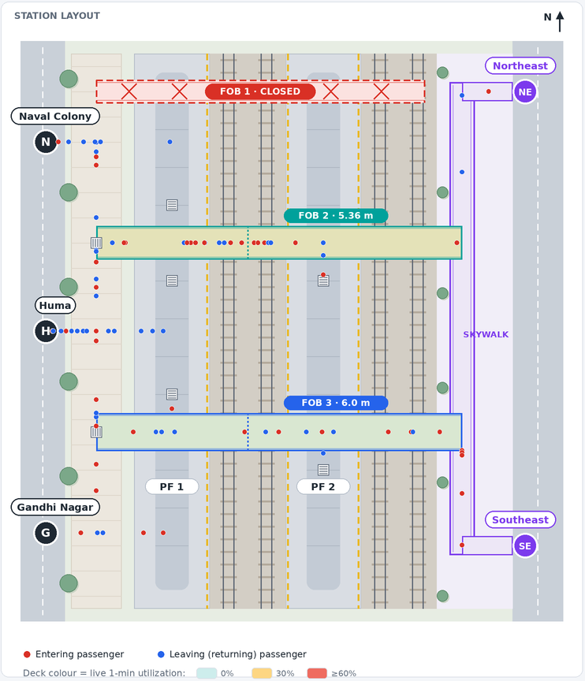
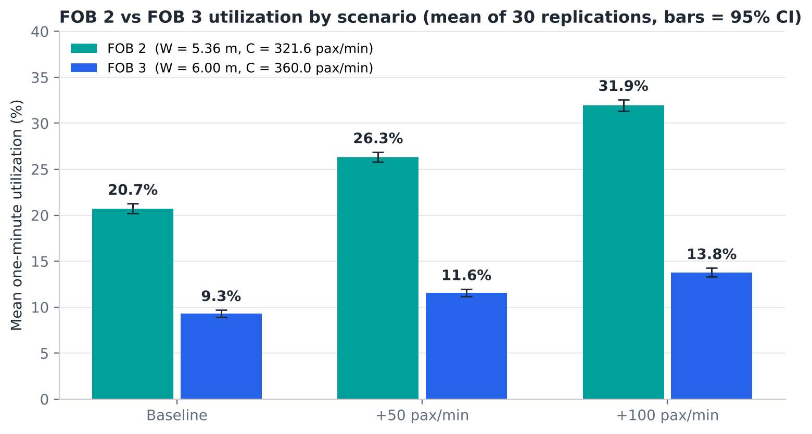
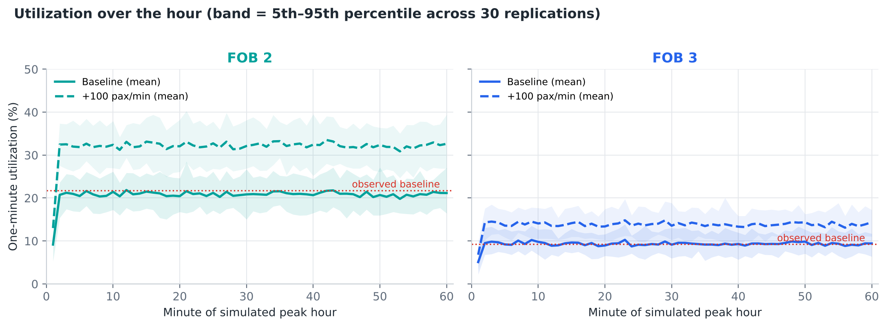

# Kanjurmarg Station: Stochastic Simulation of Foot Overbridge Utilization Under Increased Passenger Demand

*IE 301 · Operational Analysis of Multimodal Interchange Hubs — Technical report · Department of IEOR, IIT Bombay · October 2026 · Version 3 (revised route splits)*

| Key result | Value | Note |
|---|---:|---|
| FOB 2 baseline utilization | **20.7%** | → 31.9% with +100 pax/min |
| FOB 3 baseline utilization | **9.3%** | → 13.8% with +100 pax/min |
| Busiest simulated minute | **45.1%** | FOB 2, +100 pax/min (of reference capacity) |

*Utilization = one-minute FOB crossings ÷ reference capacity (W × 60 pax/m/min); mean of 30 stochastic replications. Gate route splits are modelling estimates (with random noise), the East-side split and the 500 pax/min Ghatkopar reference are assumptions, and the +50/+100 pax/min scenarios are input rates, not ridership forecasts. Simplified conceptual layout — not to scale.*


## 1. Executive Summary

A stochastic AnyLogic model estimates FOB 2 and FOB 3 utilization at Kanjurmarg for three scenarios: baseline, **+50** and **+100 pax/min** of extra entering demand (10% and 20% of an assumed 500 pax/min Ghatkopar flow; 80% via Huma, 20% via Gandhi Nagar). Five gates, FOB 1 closed, Poisson arrivals, gate route splits with ±3 pp noise, 30 replications × 60 min.


**Table 1. Mean one-minute utilization (% of reference capacity, ± 95% CI).**

| Scenario | FOB 2 | FOB 3 |
|---|---:|---:|
| Baseline | 20.7 ± 0.5 | 9.3 ± 0.4 |
| +50 pax/min | 26.3 ± 0.5 | 11.6 ± 0.4 |
| +100 pax/min | 31.9 ± 0.6 | 13.8 ± 0.5 |

- FOB 2 is about twice as loaded as FOB 3 in every scenario. +100 pax/min adds about 11 points on FOB 2 and 4 on FOB 3.
- Busiest single minute in any run: 45.1% (FOB 2, +100 pax/min). Both bridges stay below reference capacity.
- Expected baseline flows from the assumed splits (68.9 and 32.6 pax/min) are close to the observed 70.0 and 33.3 pax/min. This is a consistency check, not validation.

## 2. Problem Definition and Objectives

Kanjurmarg is expected to become an interchange with Metro Lines 4 and 6. With FOB 1 closed, bridge movement relies on FOB 2 and FOB 3. Questions:


1. How is gate demand split between direct PF1/PF1A, FOB 2, FOB 3 and the skywalk?
1. What are baseline FOB 2 and FOB 3 utilizations?
1. What changes with +50 and +100 pax/min?
1. How variable are the results?
1. How do estimated FOB flows compare with observed counts?
1. Does extra demand change the FOB 2 / FOB 3 balance?

> **Scope note.** +50 and +100 pax/min are scenario inputs, not ridership forecasts.


## 3. Scope and Simplified Station Layout

West side (north → south): Naval Colony gate, FOB 2, Huma gate, FOB 3, Gandhi Nagar gate. FOB 1 is closed. An east-side **skywalk connects FOB 2 and FOB 3** (connector, not an FOB) with Northeast and Southeast exits.




**Figure 1.** Simplified layout in the AnyLogic model (not to scale). Red = entering, blue = leaving.


**Table 2. Model scope.**

| Included | Excluded |
|---|---|
| Five gates, entering and leaving streams + 2 extra-demand streams | Ticketing, buses, autos, metro operations |
| Routes: direct PF1/PF1A, FOB 2, FOB 3, skywalk → FOB 3 | Stair/escalator capacity, density, queuing |
| FOB 2 and FOB 3 one-minute utilization | Skywalk utilization (not an FOB) |


## 4. Observed Data and Input Parameters


**Table 3. Baseline gate demand (pax/min).**

| Gate | Entering | Leaving | Total | Status |
|---|---:|---:|---:|---:|
| Naval Colony | 10.00 | 42.00 | 52.00 | Observed |
| Huma | 27.20 | 50.00 | 77.20 | Observed |
| Gandhi Nagar | 33.33 | 6.66 | 39.99 | Observed |
| Northeast | 10.00 | 5.00 | 15.00 | **Assumed: 50% of East-side count** |
| Southeast | 10.00 | 5.00 | 15.00 | **Assumed: 50% of East-side count** |
| **Total** | **90.53** | **108.66** | **199.19** |  |

*Source: IE 301 project report, Section 2.2.*


**Table 4. Observed FOB flows and widths (benchmark only).**

| Facility | Observed flow (pax/min) | Width (m) | Width status |
|---|---:|---:|---:|
| FOB 1 | Closed | – | Not in use |
| FOB 2 | 70.0 | 5.36 | Recorded; to be verified |
| FOB 3 | 33.3 | 6.0 | **Unverified** |

*Source: project report Sections 2.3 and 4.6.*


## 5. Gate Route-Choice Assumptions

Route splits are **modelling assumptions, not measured choices**. The same split applies to entering and leaving passengers at a gate.


**Table 5. Route-choice probabilities by gate.**

| Gate | Direct PF1/PF1A | Via FOB 2 | Via FOB 3 | Skywalk → FOB 3 |
|---|---:|---:|---:|---:|
| Naval Colony | 60% | 25% | 15% | 0% |
| Huma | 55% | 30% | 15% | 0% |
| Gandhi Nagar | 60% | 35% | 5% | 0% |
| Northeast | 0% | 95% | 0% | 5% |
| Southeast | 0% | 30% | 70% | 0% |
| Huma (additional demand) | 50% | 35% | 15% | 0% |
| Gandhi Nagar (additional demand) | 40% | 40% | 20% | 0% |

*Last two rows apply to the additional demand only. Skywalk users are counted on FOB 3.*


### 5.1 Route-split noise

Each replication draws each gate's split from a Dirichlet distribution around these values (κ = 99, about ±3 pp for a 10–15% share). Zero shares stay zero.


**(p_PF1, p_FOB2, p_FOB3, p_sky) ~ Dirichlet(κ · p̄),   κ = 99**   (5.1)


### 5.2 Expected flows vs observed counts


**Table 6. Expected baseline flows (no randomness) vs observed.**

| Facility | Expected (pax/min) | Expected U | Observed (pax/min) | Observed U |
|---|---:|---:|---:|---:|
| FOB 2 | 68.9 | 21.4% | 70.0 | 21.8% |
| FOB 3 | 32.6 | 9.1% | 33.3 | 9.3% |

*FOB 2 = 13.0 + 23.2 + 14.0 + 14.25 + 4.5; FOB 3 = 7.8 + 11.6 + 2.0 + 10.5 + 0.75 (skywalk).*


> **Not validation.** The splits were chosen as estimates; their agreement with observed counts is a consistency check only.


## 6. Ghatkopar-Referenced Demand Scenarios


**+50 pax/min = 500 × 0.10,     +100 pax/min = 500 × 0.20**   (6.1)


**Table 7. Additional entering demand by gate (pax/min).**

| Scenario | Huma (80%) | Gandhi Nagar (20%) | Total |
|---|---:|---:|---:|
| Baseline | 0 | 0 | 0 |
| +50 pax/min | +40 | +10 | +50 |
| +100 pax/min | +80 | +20 | +100 |

*500 pax/min Ghatkopar flow is assumed. Baseline rates are unchanged.*


**Table 8. Expected routing of the additional demand (pax/min).**

| Route | +50 pax/min | +100 pax/min |
|---|---:|---:|
| Direct PF1/PF1A | +24 | +48 |
| FOB 2 | +18 | +36 |
| FOB 3 | +8 | +16 |

*Huma extra × (50/35/15); Gandhi Nagar extra × (40/40/20).*


## 7. Stochastic Arrival and Route-Choice Model


**Table 9. Distributions.**

| Element | Distribution | Parameters |
|---|---|---|
| Arrivals (12 streams) | Poisson process | λ = gate rate; extra streams 0.8·Δ and 0.2·Δ |
| Inter-arrival time | Exponential | Mean 60/λ s |
| Gate split per replication | Dirichlet | κ = 99 |
| Route per passenger | Categorical (inverse CDF) | That replication's split |
| Walking speed | Deterministic | 1.30 m/s |


**Δt = −ln(1 − U) · 60/λ,   U ~ Uniform(0, 1)**   (7.1)

A crossing is counted once, in the minute the passenger reaches the deck mid-point. 95% CI over n = 30: x̄ ± 2.045 · s/√30. Seeds 1001–1030 are reused in every scenario (common random numbers). Empty start, no warm-up.


## 8. Capacity and Utilization Calculations


**C = W × 60 pax/m/min,     U = Q / C × 100%**   (8.1)


**Table 10. Reference capacities.**

| Facility | W (m) | C (pax/min) |
|---|---:|---:|
| FOB 2 | 5.36 | 321.6 |
| FOB 3 | 6.0 (unverified) | 360.0 |


> **Limit.** U is a reference-capacity ratio, not a level-of-service or safety measure; stairs, counter-flow and platoons are not modelled.


## 9. AnyLogic Implementation


**Table 11. Model structure (Kanjurmarg_FOB_Simulation.alp, AnyLogic 8.8).**

| Element | Role |
|---|---|
| Arrival(stream) | Poisson arrival, route choice, new passenger |
| Waypoint / Crossing | Move passengers; count FOB crossings per minute |
| minuteTick (60 s) | Utilization, gauges, deck colours, time plot |
| runBatch() | 30 replications × 3 scenarios; results to console and CSV |
| gateSplits, extraSplits, splitNoiseKappa | Editable route splits and noise |

Screen: station layout (decks coloured by live utilization), FOB 2 and FOB 3 utilization gauges (now, mean, peak) and a utilization-over-time plot.


> **Verification.** Model code compiles against AnyLogic API stand-ins; its headless run reproduced replication 1 exactly (4,157 FOB 2 and 2,058 FOB 3 crossings). Opening in AnyLogic itself is still to be confirmed.


## 10. Experimental Design


**Table 12. Experiments.**

| Factor | Setting |
|---|---|
| Scenarios | Baseline, +50, +100 pax/min |
| Runs | 60 min × 30 replications per scenario, seeds 1001–1030 |
| Route-split noise | On (κ = 99); a fixed-split set (κ = 0) is used only to size its effect |


## 11. Simulation Results


**Table 13. One-minute utilization (%), 30 replications.**

| Scenario | FOB | Mean ± 95% CI | P95 minute | Busiest minute |
|---|---:|---:|---:|---:|
| Baseline | FOB 2 | 20.7 ± 0.5 | 24.8 | 32.3 |
| Baseline | FOB 3 | 9.3 ± 0.4 | 12.0 | 16.9 |
| +50 pax/min | FOB 2 | 26.3 ± 0.5 | 31.1 | 37.6 |
| +50 pax/min | FOB 3 | 11.6 ± 0.4 | 14.5 | 19.7 |
| +100 pax/min | FOB 2 | 31.9 ± 0.6 | 37.2 | 45.1 |
| +100 pax/min | FOB 3 | 13.8 ± 0.5 | 17.1 | 23.1 |

*Source: data/scenario_summary.csv.*




**Figure 2.** FOB 2 vs FOB 3 mean utilization by scenario.




**Figure 3.** Utilization over the hour, baseline vs +100 pax/min (band = 5th–95th percentile).

About 94–96% of the replication-to-replication variance comes from route-split noise rather than random arrivals.


## 12. Interpretation


1. **Demand split:** 49% direct PF1/PF1A, 35% FOB 2, 16% FOB 3, 0.4% skywalk.
1. **Baseline:** FOB 2 20.7%, FOB 3 9.3%.
1. **Extra demand:** +5.6 / +11.2 points on FOB 2 and +2.3 / +4.5 on FOB 3 for +50 / +100 pax/min.
1. **Variability:** busiest minutes are about 30% (FOB 2) and 43% (FOB 3) above the hourly mean.
1. **Observed counts:** simulated baseline (20.7%, 9.3%) is close to observed (21.8%, 9.3%) — a consistency check, not validation.
1. **Balance:** FOB 2 carries 67% of FOB flow at baseline and 67% at +100 pax/min.

> **Implication.** Deck width is not binding even at +100 pax/min; FOB 2 is the bridge to watch. Measured route-choice data would sharpen every result.


## 13. Assumptions, Limitations, and Additional Data Required

- East-side counts split 50/50 between Northeast and Southeast.
- Gate and additional-demand route splits are assumptions, not measurements.
- 500 pax/min Ghatkopar flow is assumed; +50/+100 are scenario inputs, not forecasts.
- FOB 3 width (6.0 m) is unverified; FOB 2 width (5.36 m) to be confirmed.
- Poisson arrivals ignore train-release platoons, so peak minutes are likely understated.

**Table 14. Assumptions register.**

| ID | Assumption | Value | Evidence status |
|---|---|---|---|
| A1 | Five access gates | Naval Colony, Huma, Gandhi Nagar (west); Northeast, Southeast (east, skywalk exits) | Layout decision |
| A2 | East-side gate rates | NE and SE each 10.00 entering / 5.00 leaving pax/min | ASSUMPTION (50/50 split) |
| A3 | Baseline gate route-choice probabilities | NC 60/25/15/0, Huma 55/30/15/0, GN 60/35/5/0, NE 0/95/0/5, SE 0/30/70/0 (PF1/FOB2/FOB3/skywalk) | Modelling assumption, not measured |
| A3b | Route shares of the additional demand | Huma 50/35/15, Gandhi Nagar 40/40/20 (PF1/FOB2/FOB3) | Modelling assumption, not measured |
| A4 | Southeast split | 70% FOB 3, 30% FOB 2 | Explicit ASSUMPTION |
| A5 | Leaving passengers | Use the same route percentages as entering passengers at that gate | Assumption |
| A6 | Route-split noise | Dirichlet draw per gate per replication, concentration 99 (about +/-3 pp for a 10% share) | Modelling choice |
| A7 | Skywalk | Connector between FOB 2 and FOB 3 on the east side; 5% of Northeast users walk it to FOB 3 | Layout decision |
| A8 | FOB 1 | Closed; never offered as a route | Observed |
| A9 | Ghatkopar reference flow | 500 pax/min | ASSUMED, not independently verified |
| A10 | Additional demand | +50 and +100 pax/min entering only; 80% Huma, 20% Gandhi Nagar; own route shares (A3b) | Scenario input, not a forecast |
| A11 | Arrival process | Independent Poisson processes (exponential inter-arrival times) for 10 baseline + 2 additional streams | Simplification |
| A12 | Constant rates over 60 min | Peak-period observed rates | Simplification |
| A13 | FOB 2 width | 5.36 m | Recorded; clear width unverified |
| A14 | FOB 3 width | 6.0 m | UNVERIFIED assumption |
| A15 | Flow intensity I | 60 pax/m/min | Reference value |
| A16 | Walking speed / crossing point | 1.30 m/s; counted at FOB deck mid-point | Assumption |
| A17 | Initial state | Station starts empty, no warm-up | Assumption |
| A18 | Replications and seeds | 30 per scenario, seeds 1001-1030, common random numbers | Design choice |

*Full register: data/assumptions_register.csv.*

**Data needed:** gate-to-route counts; separate Northeast/Southeast counts; synchronised gate and FOB counts; verified clear widths; one-minute profiles with train times; a verified Ghatkopar source.


## 14. Conclusion

Under the stated assumptions, FOB 2 runs at about 21% and FOB 3 at about 9% of reference capacity at baseline, rising to about 32% and 14% with +100 pax/min. FOB 2 remains the more loaded bridge. Measured route-choice data are the key next step.


## 15. Reproducibility Appendix


### 15.1 Deliverables


**Table 15. Project files (folder kanjurmarg_fob_simulation/).**

| Path | Content |
|---|---|
| anylogic/Kanjurmarg_FOB_Simulation/Kanjurmarg_FOB_Simulation.alp | Native AnyLogic 8.8 project |
| engine/FobEngine.java | Stochastic core (embedded verbatim in the .alp) |
| engine/RunnerMain.java, scripts/run_engine.sh | Stand-alone batch runner |
| python/fob_twin.py | Independent Python re-implementation (cross-check) |
| python/analyze.py, python/make_charts.py | CSV export, verification checks, utilization charts |
| scripts/build_alp.py, check_alp_code.py, render_preview.py | Model generator, model-code check, screen preview |
| data/*.csv | observed_data, gate_route_splits, expected_route_allocation, scenario_summary, fob_time_series, replication_results, route_split_uncertainty, assumptions_register |
| charts/*.png | All figures in this report |
| README.md, VALIDATION.md | Instructions and verification record |


### 15.2 Reproducing the results

```
scripts/run_engine.sh 30 60 1.30 1001 99      # replications, minutes, walk speed, base seed, noise kappa
python3 python/analyze.py                      # CSVs + verification checks
python3 python/make_charts.py                  # utilization figures
python3 scripts/build_alp.py && python3 scripts/check_alp_code.py
```

In AnyLogic: open the .alp from a folder AnyLogic can read (on macOS not Downloads, unless AnyLogic is allowed access), run the Simulation experiment, choose a scenario and press Run. 'Run replications' runs 30 seeds × 3 scenarios inside AnyLogic and reproduces data/scenario_summary.csv; output goes to anylogic_batch_results.csv in the model folder.


### 15.3 Verification summary


**Table 16. Automated checks.**

| Check | Result |
|---|---|
| Route probabilities sum to 100% for every gate (defaults) | PASS — Naval Colony 100%; Huma 100%; Gandhi Nagar 100%; Northeast 100%; Southeast 100% |
| Additional-demand route shares sum to 100% | PASS — Huma 50/35/15, Gandhi Nagar 40/40/20 |
| Route probabilities sum to 100% for every gate (noisy draws) | PASS — checked 90 replications x (5 gates + 2 additional-demand splits) |
| Impossible routes stay impossible under noise | PASS — routes with 0% default probability are never used |
| FOB 1 remains unavailable | PASS — FOB 1 crossings over 180 replications = 0 |
| Skywalk is a connector, not an FOB | PASS — only Northeast passengers use the skywalk (8361 in total); they are counted on FOB 3 and there is no skywalk crossing count |
| Direct PF1 passengers never counted; each FOB passenger counted at most once | PASS — every replication: FOB 2 + FOB 3 crossings + passengers still approaching at t=60 = FOB-route passengers |
| East-side rates conserve the observed aggregate | PASS — Northeast + Southeast entering = 10 + 10 = 20; leaving = 5 + 5 = 10 pax/min |
| Baseline gate totals | PASS — entering 90.53, leaving 108.66, total 199.19 pax/min |
| Additional demand total and 80/20 split (+50 pax/min) | PASS — Huma +40, Gandhi Nagar +10, total +50 pax/min; Huma entering 67.20, Gandhi Nagar entering 43.33 |
| Additional Huma arrivals are Poisson (+50 pax/min) | PASS — mean 2406.9 per hour vs expected 2400 (z = +0.77) |
| Additional Gandhi Nagar arrivals are Poisson (+50 pax/min) | PASS — mean 598.3 per hour vs expected 600 (z = -0.39) |
| Additional demand total and 80/20 split (+100 pax/min) | PASS — Huma +80, Gandhi Nagar +20, total +100 pax/min; Huma entering 107.20, Gandhi Nagar entering 53.33 |
| Additional Huma arrivals are Poisson (+100 pax/min) | PASS — mean 4792.5 per hour vs expected 4800 (z = -0.60) |
| Additional Gandhi Nagar arrivals are Poisson (+100 pax/min) | PASS — mean 1193.4 per hour vs expected 1200 (z = -1.04) |
| Expected additional routing +50 | PASS — PF1 +24, FOB 2 +18, FOB 3 +8 pax/min (expected values, reported separately from simulation) |
| Expected additional routing +100 | PASS — PF1 +48, FOB 2 +36, FOB 3 +16 pax/min (expected values, reported separately from simulation) |
| Baseline streams unchanged by scenarios (no multipliers) | PASS — with the same seed, all 10 baseline gate-direction streams generate identical arrivals in every scenario |
| Poisson arrival counts for the 10 baseline streams | PASS — z-scores of hourly means vs lambda x 60: +0.2, +0.9, +0.9, +1.4, +0.5, -0.6, -1.3, -0.9, +0.8, -2.5 |
| Per-passenger route choice follows each replication's split | PASS — pooled chi-square = 946.5 on 960 df, p = 0.616 (1,077,324 passengers) |
| Route-split noise has the intended size | PASS — SD of Naval Colony FOB 3 share (15%) across replications = 3.5 pp (theory 3.6 pp) |
| Different seeds generate different trajectories | PASS — 30 distinct arrival-count vectors from 30 seeds |
| Java engine reproduced by independent Python implementation | PASS — identical per-minute FOB 2 counts for sampled replications (full comparison of all 180 replications: 0 mismatches) |
| Capacity units | PASS — C2 = 5.36 m x 60 pax/m/min x 1 min = 321.6 pax; C3 = 6.0 x 60 x 1 = 360 pax |
| Simulated results recorded separately from expected values | PASS — baseline simulated minus expected flow: FOB 2 -2.25 pax/min, FOB 3 +0.81 pax/min |
| Java engine vs Python twin, all 180 replications | PASS — 0 mismatches in arrivals, route counts, noisy splits and per-minute crossings |
| Model code compile (scripts/check_alp_code.py) | PASS — all functions, events and 14 dynamic expressions compile against AnyLogic API stand-ins |
| Model event logic executed headless | PASS — identical to batch replication 1 (seed 1001); in-model replications reproduce scenario_summary.csv |
| Opened and run in AnyLogic 8.8 | NOT YET CONFIRMED — to be checked on the user's computer |


### 15.4 Software

Java (OpenJDK 21), Python 3.13 with NumPy 2.5, pandas 3.0, SciPy 1.18 and Matplotlib 3.11. Target: AnyLogic 8.8 (Personal Learning Edition compatible; no paid libraries).
